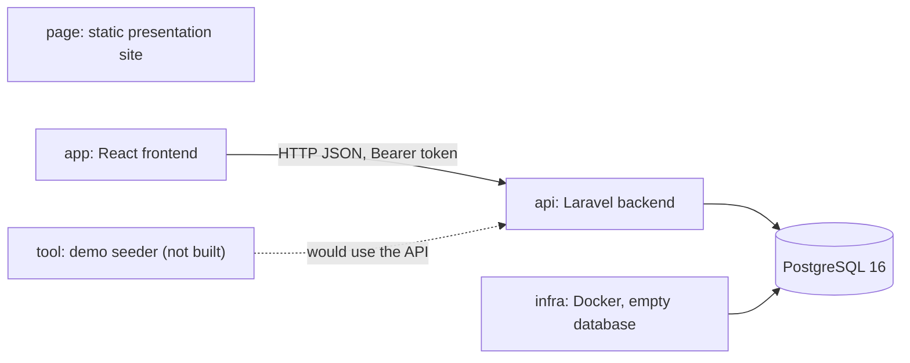
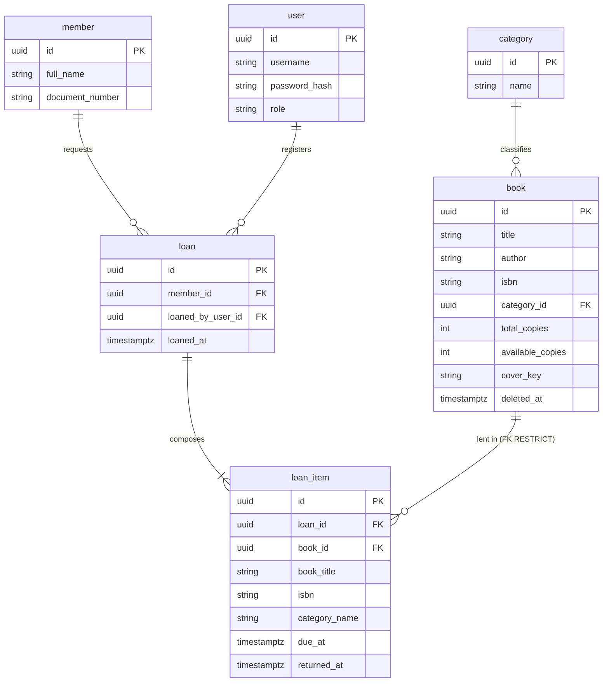
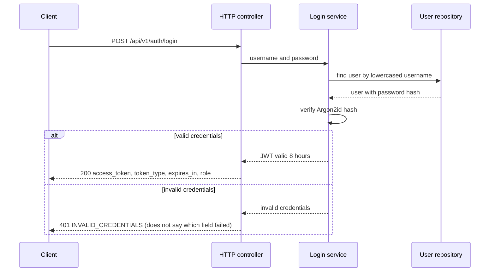
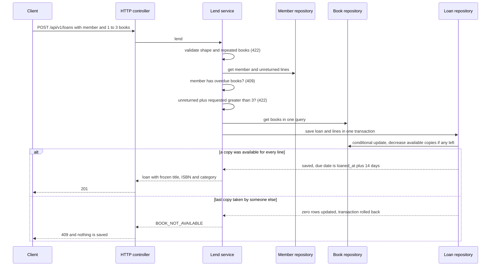
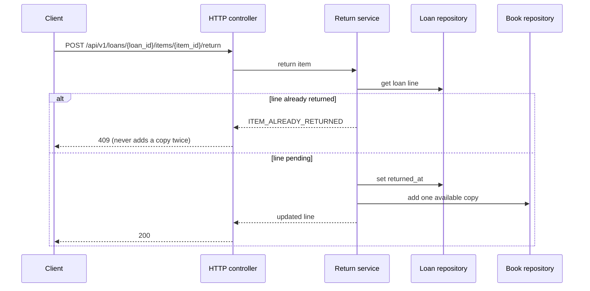
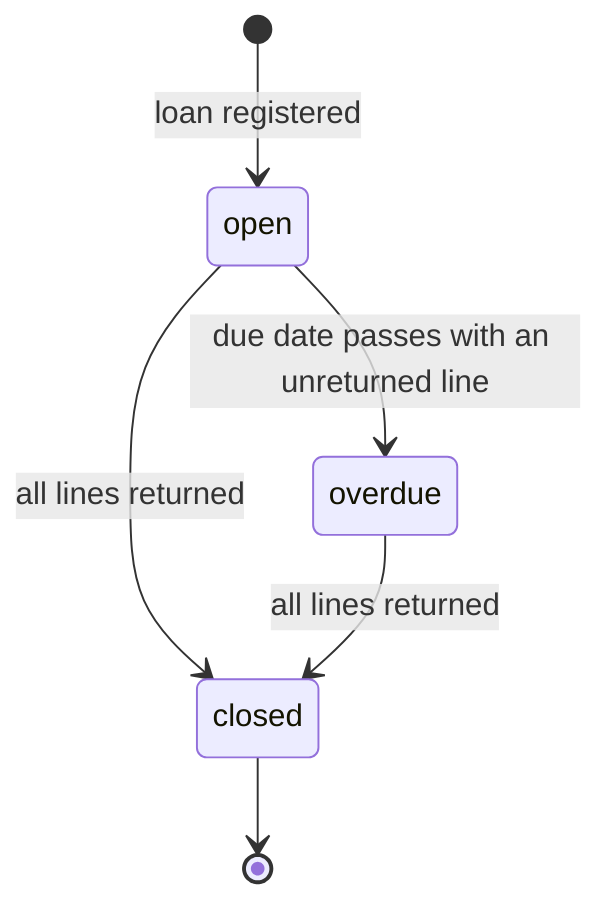

# Diagrams — Manager Library

Diagrams of the system as built (Laravel + React), following the spec. GitHub renders the Mermaid blocks below.

## 1. System overview

The `page` repo is independent: it never calls the API. The schema belongs to the Laravel migrations; `infra` only starts an empty engine.

## 2. Data model (six tables)

`book_title`, `isbn` and `category_name` in `loan_item` are frozen at loan time (RN-4) and do not follow the catalog. The loan status is calculated, never stored.

## 3. Sequence: log in

## 4. Sequence: register a loan

The order of the checks is decision 5 in `spec-gaps-and-decisions.md`; the conditional update is decision 1.

## 5. Sequence: return one line

## 6. Loan status (calculated, not stored)

